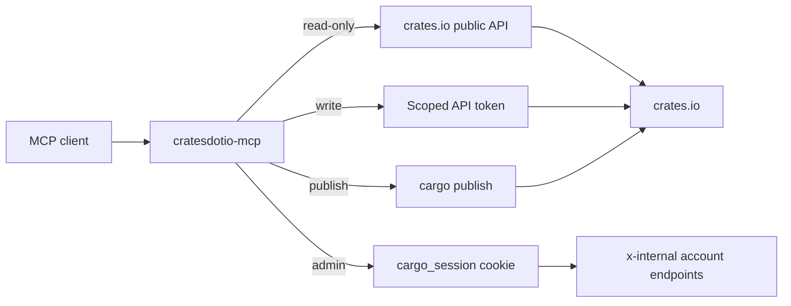

<div align="center">

# cratesdotio-mcp

**Publish and manage crates.io from your agent, with an explicit safety gate.**

A Rust [Model Context Protocol](https://modelcontextprotocol.io/) server for [crates.io](https://crates.io). Read crate data by default, then unlock scaffolding, publishing, owner changes, trusted publishing, and account operations one mode at a time.

[](https://github.com/hongkongkiwi/crates.io-publisher-mcp/actions/workflows/ci.yml) [](LICENSE) [](https://www.rust-lang.org/) [](https://modelcontextprotocol.io/)

[Install](#install) · [Quick start](#quick-start) · [Modes](#modes) · [Authentication](#authentication) · [Tools](#tools) · [Workflows](#workflows) · [Security](#security) · [Configuration](#configuration) · [Development](#development)

</div>

> The server refuses to start without an explicit mode. A process that can publish cannot start by accident.

## What it does

The package is `crates-io-publisher-mcp`. The installed binary and MCP server name is `cratesdotio-mcp`.

| Surface | What you get |
| --- | --- |
| Read-only | Search, crate metadata, versions, dependencies, docs links, name availability |
| Write | Owner management, yank and unyank, trusted publishing configuration |
| Publish | Local scaffolding, workflow generation, `cargo publish` with a dry run by default |
| Admin | Whoami, API token management, crate deletion, with a browser session cookie |
| Safety | Mode gating, scoped tokens, exact publish confirmations, redacted output, audit log |



## Install

```bash
cargo install --git https://github.com/hongkongkiwi/crates.io-publisher-mcp --locked
```

Or build from source:

```bash
git clone https://github.com/hongkongkiwi/crates.io-publisher-mcp
cd crates.io-publisher-mcp
cargo build --release
./target/release/cratesdotio-mcp --help
```

## Quick start

Store a token once. The input is hidden and the value is written with mode 0600:

```bash
cratesdotio-mcp login
cratesdotio-mcp status
```

Start the stdio server in the mode you need:

```bash
cratesdotio-mcp --mode read-only
CRATES_IO_TOKEN=... cratesdotio-mcp --mode publish
cratesdotio-mcp --mode admin
```

MCP client configuration:

```json
{
  "mcpServers": {
    "crates-io": {
      "command": "/path/to/cratesdotio-mcp",
      "args": ["--mode", "publish"],
      "env": { "CRATES_IO_TOKEN": "..." }
    }
  }
}
```

If you used `cratesdotio-mcp login`, the token is already in the config directory and the `env` block can be omitted.

## Modes

The server refuses to start without `--mode` or `CRATES_MCP_MODE`. There is no default mode. Lower modes do not list higher-mode tools, and calling a hidden tool returns an error naming the required mode.

| Mode | What it adds | Credential | HTTP |
| --- | --- | --- | --- |
| `read-only` | Search, crate info, versions, dependencies, docs, name availability | None | Yes |
| `write` | Owner management, yank and unyank, trusted publishing configuration | API token | Loopback only |
| `publish` | Local scaffolding, workflow generation, `cargo publish` | API token | Loopback only |
| `admin` | Whoami, token listing, creation and revocation, crate deletion | Session cookie, plus a token for write and publish tools | No, stdio only |

`admin` has no HTTP transport because the HTTP server has no authentication layer.

## Authentication

Create a token at https://crates.io/settings/tokens with only the scopes you need.

| Scope | Allows |
| --- | --- |
| `publish-new` | Publish a crate for the first time |
| `publish-update` | Publish new versions of an existing crate |
| `yank` | Yank and unyank versions |
| `change-owners` | Add and remove owners |
| `trusted-publishing` | Manage trusted publishing configurations and the trustpub-only flag |

The server reads the token from the first source that provides one:

1. `CRATES_IO_TOKEN`
2. `CARGO_REGISTRY_TOKEN`
3. `$CRATES_MCP_CONFIG_DIR/token`, written by `cratesdotio-mcp login` or `mint-token`
4. `$CARGO_HOME/credentials.toml`, `registries.crates-io.token` or the legacy `registry.token`

A token is never accepted as a tool argument, because tool arguments end up in model context and transcripts. Values are redacted from debug output and never logged.

```bash
# Paste a token once, with hidden input
cratesdotio-mcp login

# Create a scoped token from a stored session cookie
cratesdotio-mcp mint-token --name laptop-mcp --scopes publish-update,yank

# Show which credentials exist, without printing values
cratesdotio-mcp status

# Remove stored credentials
cratesdotio-mcp logout
```

`mint-token` stores the new token at `$CRATES_MCP_CONFIG_DIR/token` and does not print it unless `--reveal` is passed. Use `--reveal` when you need the value for a CI secret.

When this tool creates a token, it records the id, name, and scopes in `$CRATES_MCP_CONFIG_DIR/token-meta.json` with mode 0600. `crates_auth_status` and `status` show that record, which is the only way to know the scopes of a token after crates.io returns it once. A token imported with `login` has no record.

### Session cookie for admin mode

`admin` mode needs the `cargo_session` cookie:

```bash
cratesdotio-mcp session
```

The command opens the token page, explains where to find the cookie in browser devtools, reads the value with hidden input, verifies it with a whoami request, and stores it at `$CRATES_MCP_CONFIG_DIR/session` with mode 0600.

The cookie grants full account authority: token creation, crate deletion, email and account settings. It is loaded only in `admin` mode, never accepted as a tool argument, redacted from output, and never sent over plaintext HTTP. The tool never handles your GitHub password and never automates the GitHub login or 2FA.

## Tools

Read-only tools are available in every mode. The other groups unlock with their mode.

<details>
<summary>Show all tools</summary>

| Tool | Purpose |
| --- | --- |
| `search_crates` | Search by name or keyword |
| `get_crate_info` | Crate metadata and latest version |
| `get_crate_versions` | Published versions and yank state |
| `get_crate_dependencies` | Dependencies of a version |
| `get_crate_documentation` | docs.rs links |
| `check_crate_name` | Validate syntax and check whether the name is taken |
| `crates_auth_status` | Report mode, token and cookie presence, their sources, and recorded scopes. Never prints values |

`write` mode:

| Tool | Token scope |
| --- | --- |
| `list_crate_owners` | None, owner data is public |
| `add_crate_owner` | `change-owners` |
| `remove_crate_owner` | `change-owners` |
| `yank_crate_version` | `yank` |
| `unyank_crate_version` | `yank` |
| `list_trustpub_github_configs` | `trusted-publishing` |
| `create_trustpub_github_config` | `trusted-publishing` |
| `delete_trustpub_github_config` | `trusted-publishing` |
| `set_trustpub_only` | `trusted-publishing` |

`publish` mode:

| Tool | Purpose |
| --- | --- |
| `scaffold_crate` | `cargo new` plus a publishable `Cargo.toml` and README |
| `publish_crate` | `cargo publish`, with a dry run by default |
| `generate_publish_workflow` | Write `.github/workflows/<name>.yml` using trusted publishing |

`admin` mode, with a session cookie. A token is also needed for write and publish tools.

| Tool | Purpose |
| --- | --- |
| `crates_whoami` | Account login, email verification state, owned crates |
| `list_api_tokens` | Active tokens with scopes, creation and last-used times |
| `create_api_token` | Create a scoped token. Stores it by default instead of returning it |
| `revoke_api_token` | Revoke a token by id, confirmed with `revoke <id>` |
| `delete_crate` | Permanently delete a crate, confirmed with `delete <name>` |

</details>

## Workflows

### New crate

```
scaffold_crate { name, parent_dir, description, license, repository }
```

Add code and dependencies, then commit the new files. Cargo refuses to publish a dirty git tree unless `allow_dirty` is set.

```
publish_crate { directory, dry_run: true }
```

The dry run packages the crate and runs the verification build. When it passes:

```
publish_crate { directory, dry_run: false, confirm: "name@0.1.0" }
```

A real publish requires `confirm` to equal `name@version` exactly. Publishing is irreversible after 72 hours, and a version number can never be reused.

### CI with trusted publishing

Trusted publishing lets GitHub Actions publish with a short-lived OIDC token, so no long-lived secret lives in the repository.

The crate must exist before a trusted publishing configuration can be created. The order for a new crate is:

1. Publish the first version with a scoped token.
2. `generate_publish_workflow { directory, name, filename }`
3. Commit and push the workflow to the default branch.
4. `create_trustpub_github_config { name, repository_owner, repository_name, workflow_filename }`
5. Optionally `set_trustpub_only { name, trustpub_only: true }` to stop long-lived tokens from publishing new versions.
6. Tag a release. The workflow calls `rust-lang/crates-io-auth-action@v1`, gets a short-lived token, and runs `cargo publish`.

The `workflow_filename` in the config must match the file in `.github/workflows`. Creating the config also requires the crates.io account to have a linked GitHub account, a verified email, and ownership of the crate.

Generated workflows pin `actions/checkout`, `dtolnay/rust-toolchain`, and `crates-io-auth-action` to commit SHAs. Pass `pin_actions: false` to use moving tags and branches instead.

### Existing crate

```
publish_crate { directory, dry_run: true }
publish_crate { directory, dry_run: false, confirm: "name@version" }
```

### Yank, owners, trustpub

Yank and unyank are reversible and need no confirmation. Owner changes may create invitations that the invitee must accept. `set_trustpub_only` rejects publishes from long-lived tokens but does not revoke tokens that already exist.

### Account operations and deletion

In `admin` mode, with a stored session cookie:

```
crates_whoami
list_api_tokens
create_api_token { name: "laptop-mcp", endpoint_scopes: ["publish-update", "yank"] }
delete_crate { name: "old-crate", confirm: "delete old-crate" }
```

`create_api_token` writes the new value to the token file and reports only the id and path, so the secret stays out of the transcript. Set `reveal: true` only when you need the value in the conversation. The running server keeps the token it loaded at startup, so restart it after creating a new one.

`delete_crate` is permanent. crates.io allows it within 72 hours of creation, or for a single-owner crate with under 1000 downloads per month, no reverse dependencies, and no team owners. The name stays reserved for 24 hours.

## Security

| Control | Behavior |
| --- | --- |
| Mode gate | No default mode. Higher-mode tools are not listed, and direct calls name the required mode |
| Token handling | Never a tool argument, redacted in logs and output, read once at startup |
| Publish confirmation | Dry run by default. A real publish needs `name@version` exactly |
| Admin cookie | Full account authority, stored 0600, loaded only in admin mode, stdio only |
| HTTP exposure | Write and publish refuse a non-loopback bind. Admin refuses HTTP |
| Audit | One JSON line per write, publish, or admin action, with no credential values |
| Credential scrubbing | Cargo output and API responses are scrubbed, including build failures |

`cargo publish` runs the crate's build scripts and proc macros. Publish mode is local code execution. Do not point it at untrusted crates.

Publishing is permanent after 72 hours. The `confirm` argument exists to stop accidental publishes, including from an agent that guessed the next version. Crate deletion is permanent and requires `confirm` to name the crate.

Credentials are read once at startup and passed to cargo through the environment, not the command line. Credential files are written atomically.

## Limitations

- Automating the GitHub login is not supported. crates.io signs in through GitHub OAuth. A scripted login would need your GitHub password and 2FA, and the resulting session would be the same full-authority credential the cookie already is. Import a real browser session instead.
- A token value cannot be mapped to its scopes. crates.io returns a token value only once, at creation, and never exposes it again. `list_api_tokens` shows every token's scopes, but cannot tell you which entry belongs to the value in `CRATES_IO_TOKEN`. A missing scope shows up as HTTP 403 on the first operation.
- A crate cannot be created without publishing. There is no create-crate endpoint. A crate exists after its first version is uploaded, so trusted publishing can only be configured after that first publish.

## Configuration

| Variable | Purpose |
| --- | --- |
| `CRATES_MCP_MODE` | Same as `--mode` |
| `CRATES_IO_TOKEN` | Token, highest precedence |
| `CARGO_REGISTRY_TOKEN` | Token, second precedence |
| `CRATES_IO_COOKIE` | `cargo_session` cookie value for admin mode, highest precedence |
| `CRATES_IO_COOKIE_FILE` | File containing the `cargo_session` value |
| `CRATES_MCP_CONFIG_DIR` | Credential directory, default `$XDG_CONFIG_HOME/cratesdotio-mcp` or `~/.config/cratesdotio-mcp` |
| `CRATES_MCP_BASE_URL` | Base URL for authenticated API calls, default `https://crates.io`. The read client always uses crates.io. Token calls allow loopback HTTP for tests; the session-cookie client always requires HTTPS |
| `CARGO` | Path to the cargo binary, used for scaffolding and publishing |

### HTTP

```bash
cratesdotio-mcp --mode read-only --http 3000
```

```json
{
  "mcpServers": {
    "crates-io": {
      "serverUrl": "http://localhost:3000/sse"
    }
  }
}
```

HTTP is available for read-only, write, and publish modes. `admin` has no HTTP transport.

### Docker

The image runs read-only HTTP:

```bash
docker build -t cratesdotio-mcp .
docker run -d -p 8080:8080 cratesdotio-mcp --http 8080
```

The image runs read-only HTTP. Publish mode needs the crate and cargo on the same filesystem, so use stdio for real publishing. Write and publish over HTTP are restricted to loopback; admin is stdio only.

## Audit log

Write, publish, and admin operations append one JSON line to `$CRATES_MCP_CONFIG_DIR/audit.log` with mode 0600: timestamp, mode, action, target, result, and an exit code where relevant. Credential values are never logged. If the log cannot be written, the operation still succeeds and a warning is logged.

## Stability

The admin tools call crates.io endpoints that crates.io marks `x-internal`. They work today, but they are not public API and can change without notice. The contract tests in `tests/api_contract.rs` catch changes on our side; they cannot detect a server-side change.

## Development

```bash
cargo fmt --all
cargo clippy --all-targets -- -D warnings
cargo test
```

Tests cover token and cookie precedence and redaction, mode gating, crate name and version validation, manifest rendering, publish preflight rules, workflow rendering, the CLI gates, and crates.io request contracts against a local `wiremock` server. They do not contact crates.io. CI runs with `--locked`.

Releasing this server: `.github/workflows/ci.yml` runs format, clippy, and tests. `.github/workflows/publish.yml` publishes with trusted publishing. The first publish is manual with a scoped token. After that, add a trusted publisher for `hongkongkiwi/crates.io-publisher-mcp` with workflow `publish.yml`; pushing a `v*` tag publishes.

## License

MIT. See [LICENSE](LICENSE).
